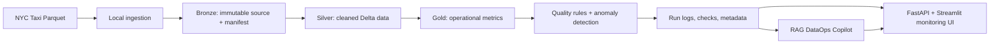

# AI DataOps Copilot

An educational, local-first DataOps project that will grow into a monitored lakehouse pipeline and an evidence-grounded troubleshooting assistant. The dashboard image in the project brief is a future UI target, not a description of the first milestone.

## What we're building

The pipeline will ingest NYC Taxi trip data, transform it through Bronze, Silver, and Gold layers, detect quality issues and anomalies, and help engineers investigate incidents using retrieved operational evidence. Consequential actions remain under human control.



## Current milestone: idempotent local ingestion

This first slice copies a Parquet source file into a local Bronze directory and records its batch ID, original filename, SHA-256 checksum, ingestion timestamp, and row count. Repeating the same batch ID for the same file returns the existing manifest; reusing that ID for different content is an error.

### Setup

Requires Python 3.10 or newer.

```powershell
python -m venv .venv
.\.venv\Scripts\Activate.ps1
python -m pip install -e ".[dev]"
```

### Run

```powershell
ai-dataops-ingest --source data\sample\yellow_tripdata_2024-01.parquet --batch-id yellow-2024-01
```

The output is written to `data\bronze\yellow-2024-01\` by default. To choose a different Bronze root:

```powershell
ai-dataops-ingest --source data\sample\yellow_tripdata_2024-01.parquet --batch-id yellow-2024-01 --bronze-dir D:\data\bronze
```

Place data files under `data\sample\` manually; raw datasets are intentionally not committed. See [data/README.md](data/README.md) for the dataset source and download guidance.

### Tests

```powershell
python -m pytest
```

## Learning path

We'll build and test one layer at a time:

1. Local ingestion, batch metadata, and idempotency.
2. Bronze/Silver/Gold transformations and Delta Lake.
3. Configurable data-quality rules and reproducible fault injection.
4. Statistical baselines, then evaluated anomaly detection.
5. RAG over runbooks and pipeline evidence, with citations.
6. Orchestration, API, and the monitoring/Copilot UI shown in the brief.
7. CI, evaluation, cost notes, and deployment as optional extensions.

The local path is the source of truth for development. Azure and Databricks are later integration targets, not prerequisites for learning or running unit tests.

See the [phase-by-phase project plan](docs/PROJECT_PLAN.md) for current progress, upcoming work, and test expectations.
